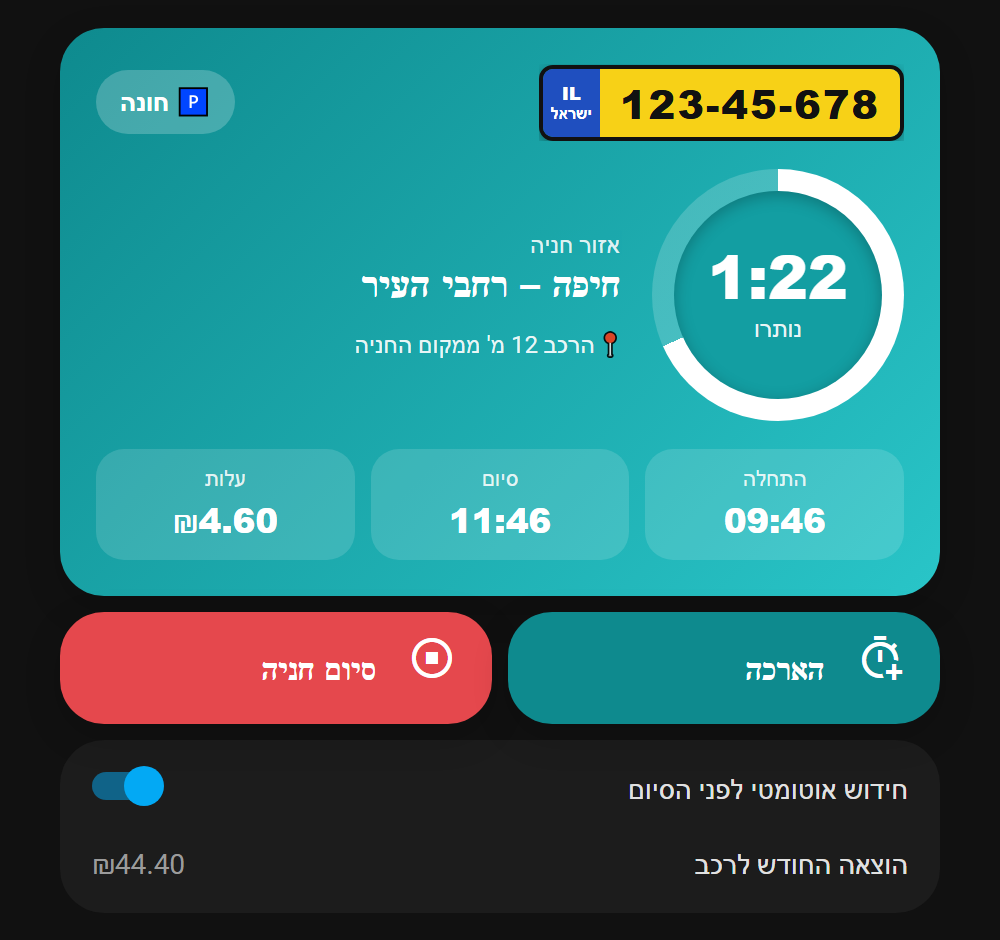
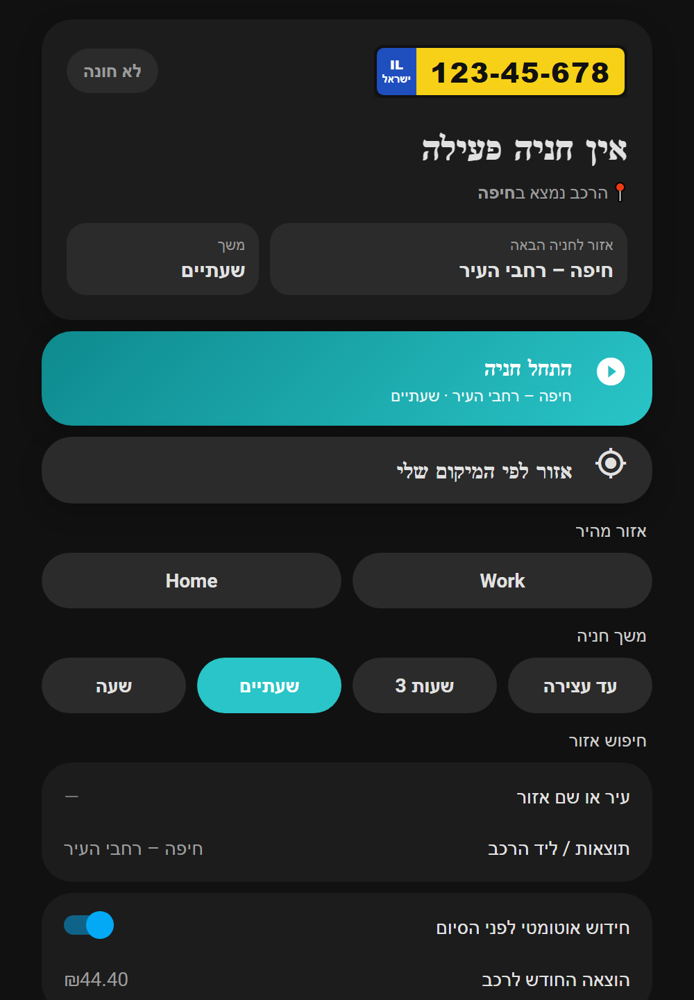
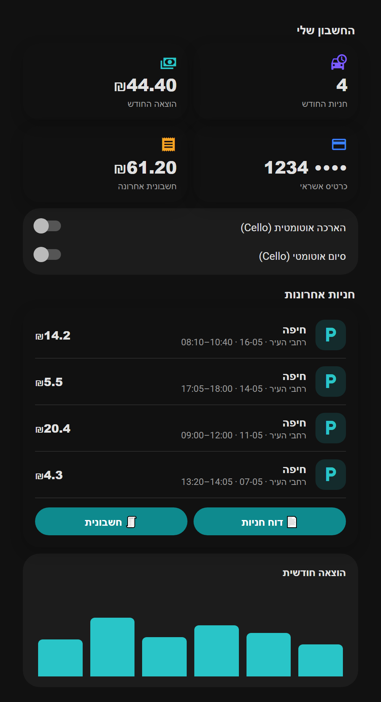

# Cello for Home Assistant

Unofficial Home Assistant integration for **Cello** (formerly Cellopark), the Israeli street-parking app.

Sign in with your phone number and the SMS code Cello texts you. Every car on the account becomes a device.

## Per car
- **Parking** (on while a parking runs), zone, start, Cello's end time, running cost
- **Start parking / Stop parking / Extend parking** buttons
- **Parking zone** picker and **Park for** (hours, 0 = until stopped) used by Start
- **Auto-renew**: Home Assistant extends the parking a few minutes before Cello would end it
- Spent this month, last parking

## Account
- Balance, spent this month (with the last parkings and the month's PDF report), parkings this month
- Last invoice, payment card (last 4 digits)
- Cello's own **auto-extend** and **auto-stop** services

## Actions
`cello.start_parking` (car, optional city/zone, hours or until, accept_message), `cello.stop_parking`,
`cello.extend_parking`, `cello.find_zones` (latitude/longitude → cities and zones).

## Events
`cello_parking` with `type`: `started`, `ended`, `reminder`, `ending_soon`, `renewed`, `renew_failed`.

## Options
Refresh interval, reminder after N minutes (0 = off), auto-renew lead time.

Starting, extending and stopping parking costs real money on your Cello account.

## Example dashboard
[`examples/dashboard.yaml`](examples/dashboard.yaml) is a ready dashboard (Hebrew, right-to-left): an Israeli plate,
a countdown ring while parked, Start / Stop / Extend, zone from location, quick-zone and duration chips, zone search,
account totals and recent parkings. It needs [button-card](https://github.com/custom-cards/button-card) from HACS.
Paste it into a new dashboard's raw configuration editor, then replace `12345678` with your plate and the two
`CITY – ZONE [...]` chips with zones from your car's Parking zone list.

| Parked | Not parked | Account |
| --- | --- | --- |
|  |  |  |

The screenshots use invented data; `python examples/render_screenshots.py` redraws them from the dashboard file.
